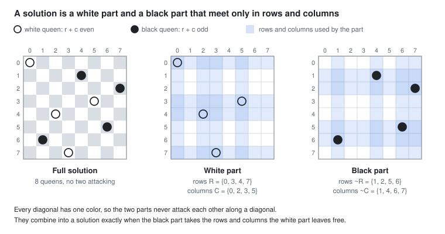
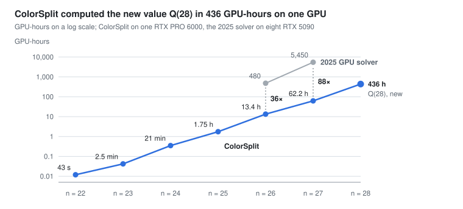
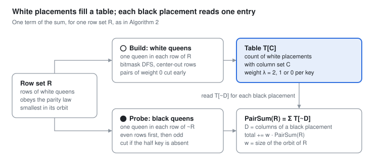
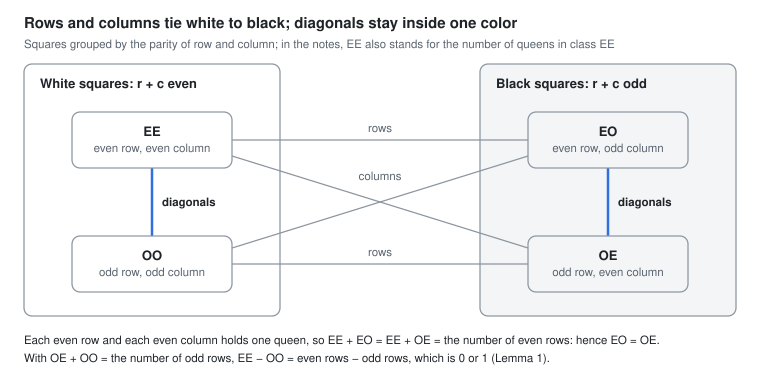
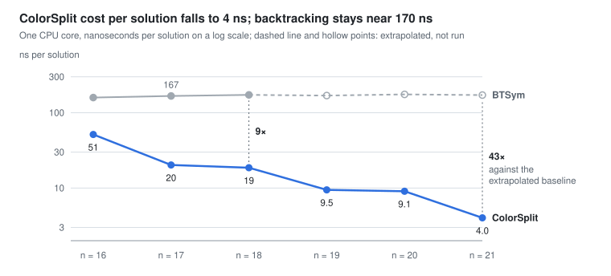

# ColorSplit: counting n-queens solutions by splitting the board into colors

ColorSplit computes Q(n), the number of ways to place n non-attacking queens on an n × n
board ([OEIS A000170](https://oeis.org/A000170)), exactly and without visiting the solutions
one by one. On one GPU it computed the previously unknown value

**Q(28) = 2,564,269,152,506,723,832**

in 436 GPU-hours, recomputed Q(27) = 234,907,967,154,122,528 in 62 GPU-hours and computes
Q(26) in 13.4 hours. On one CPU core it computes Q(21) in 21 minutes, about 4 ns per solution.
All 4096 partial sums of Q(25), Q(26), Q(27) and Q(28) are in [`results/`](results/), so any part of
these results can be recomputed independently.

<picture>
  <source media="(prefers-color-scheme: dark)" srcset="docs/figures/fig1-color-split-dark.svg">
  
</picture>

## Results

All values up to n = 27 agree with OEIS A000170; Q(28) was not known before. GPU: one NVIDIA
RTX PRO 6000 Blackwell Server Edition (Google Colab); CPU: rented cloud servers (DigitalOcean).

| n  | Q(n)                        | One GPU | Other runs |
|----|-----------------------------|---------|------------|
| 22 | 2,691,008,701,644           | 43 s    | CPU server (Java) |
| 23 | 24,233,937,684,440          | 2.5 min | 72 min on 8 vCPUs (C) |
| 24 | 227,514,171,973,736         | 21 min  | 22 h on 8 vCPUs (Java) |
| 25 | 2,207,893,435,808,352       | 1.75 h  | 33.5 h on a CPU server (Java); all 4096 partial sums in [`results/`](results/) |
| 26 | 22,317,699,616,364,044      | 13.4 h  | all 4096 partial sums in [`results/`](results/) |
| 27 | 234,907,967,154,122,528     | 62.2 h  | all 4096 partial sums in [`results/`](results/) |
| 28 | 2,564,269,152,506,723,832   | 436.4 h | new; all 4096 partial sums in [`results/`](results/) |

For comparison, the GPU solver of 2025 ([arXiv:2511.12009](https://arxiv.org/abs/2511.12009))
needed 2.5 days on eight RTX 5090 GPUs for Q(26) (about 480 GPU-hours) and 28.4 days for Q(27)
(about 5450 GPU-hours), and estimated that earlier implementations would need decades for
Q(28). Details of every run, and how Q(28) was checked, are in
[`results/README.md`](results/README.md).

<picture>
  <source media="(prefers-color-scheme: dark)" srcset="docs/figures/fig5-gpu-hours-dark.svg">
  
</picture>

## How it works

**The color split.** Color the board like a chessboard: square (r, c) is white when r + c is
even. Both diagonal directions keep r + c even or odd, so a white queen and a black queen never
share a diagonal; they interact only through rows and columns. If the white queens use the rows
R and the columns C, the black queens use exactly the other rows and columns:

$$Q(n) = \sum_{R} \sum_{|C| = |R|} W_R(C)\, B_{\overline{R}}\bigl(\overline{C}\bigr)$$

where W_R(C) counts the placements of non-attacking queens on white squares, one in each row of
R, using exactly the columns C, and B counts the same on black squares. For each row set R the
program enumerates the white placements once and counts them in a table indexed by C; then it
enumerates the black placements on the remaining rows, and each one adds a single table entry,
the one at the complement of its column set. Solutions are counted in bulk, never built, so the
cost per solution falls as n grows.

<picture>
  <source media="(prefers-color-scheme: dark)" srcset="docs/figures/fig3-table-and-probe-dark.svg">
  
</picture>

**The parity law.** Split the squares by the parities of row and column into four classes EE,
EO, OE and OO. Counting the queens in the even rows and in the even columns shows that, in every
solution, the white queens in even rows are as many as those in odd rows (one more for odd n).
Only about 18% of the row sets R (at n = 20) can therefore contribute.

<picture>
  <source media="(prefers-color-scheme: dark)" srcset="docs/figures/fig2-parity-classes-dark.svg">
  
</picture>

**Further reductions**, each measured in the paper:

- the board symmetries acting on row sets (one row set per orbit, weighted by the orbit size;
  for odd n a left–right mirror on the first row, nested to the second row when the first queen
  is in the center column);
- a weighted transposition: transposing the board maps a pair (R, C) to (C, R), so each table
  entry gets a weight 2, 1 or 0 from a symmetry invariant, and branches of weight 0 are cut early;
- half-key pruning: the probing color fixes the odd-column half of its key first and stops when
  no table key has that half;
- rows enumerated from the center of the board outwards;
- a compact table indexed by the combinatorial ranks of the even- and odd-column halves of the
  key (about 30 times smaller than a table with 2^n cells at n = 28);
- the color with more rows goes into the table.

## Repository layout

```
cpu/colorsplit.c          CPU version in C (POSIX threads); the fastest on CPUs
cpu/java/ColorSplit.java  CPU version in Java (runs without a compilation step)
cpu/README.md             long runs on a CPU server, splitting the work over machines
gpu/colorsplit.cu         GPU version in CUDA (also builds as a CPU emulation for testing)
gpu/colorsplit_v2.cu      archival GPU version that computed Q(25), Q(26) and Q(27)
gpu/README.md             building and running on a GPU, step by step on Google Colab
baselines/                bitmask backtracking with and without symmetries, for comparison
tools/verify.py           check, compare and merge checkpoint files (exact integers)
tools/status.py           progress and time left of a long run
tools/linear_laws.py      Lemma 2: no linear law beyond row and column sums for n = 9..32
tools/run_cpu_server.sh   build and run on a fresh Linux server
tests/run_tests.sh        self-test (make test), about a minute, no GPU needed
tests/check_reductions.sh each reduction switched off gives the same table cells and chunk sums
results/                  checkpoint files of Q(25) to Q(28) with all 4096 partial sums each, run details
docs/figures/             the figures of this page and of the paper
```

## Quick start

CPU, C version (Linux or macOS with gcc or clang):

```
git clone https://github.com/SergeyChere/colorsplit-nqueens.git && cd colorsplit-nqueens
make                         # builds bin/colorsplit
./bin/colorsplit 1 18        # Q(1)..Q(18), each line ends with OK when it matches OEIS
./bin/colorsplit 21 21 -t 8  # one larger board on 8 threads
```

On AMD Zen 2 and older processors build with `make CPU_EXTRA=-DSOFT_PEXT` (these CPUs execute
the PEXT instruction slowly). Options and long runs: [`cpu/README.md`](cpu/README.md).

CPU, Java version (Java 11 or later):

```
java -Xmx2g cpu/java/ColorSplit.java 1 18
```

GPU (CUDA 12 or later; see [`gpu/README.md`](gpu/README.md) for Google Colab):

```
make gpu                     # builds bin/colorsplit_gpu for the GPU in this machine
./bin/colorsplit_gpu 4 22    # Q(4)..Q(22), each checked against OEIS
```

Without a GPU, the GPU code can be checked in CPU emulation (slow, for testing only):

```
make emu && ./bin/colorsplit_emu 1 14 -t 32
```

Self-test of everything: `make test`. To check that the reductions (mirror, early cut, half-key
pruning) leave every table cell and every chunk sum unchanged: `make check-reductions`.

## Long runs, checkpoints and splitting the work

All versions split the row sets into the same 4096 chunks (chunk k holds the row sets R with
k · 2^(n−12) ≤ R < (k+1) · 2^(n−12)) and, for n ≥ 20, write one line per finished chunk to a
checkpoint file `colorsplit_n<n>.ckpt`:

```
<chunk> <sum> <milliseconds> ok
```

Running the same command again resumes from the file. The chunk sums do not depend on the
implementation, the number of threads or the table side, so a run can be continued by another
version, split over machines and checked chunk by chunk:

- **Split.** C: `-part I/K`; Java: `-Dpart=I/K`; GPU: `-chunks FILE` (or `-from A -to B`).
  For even n all the work lies in chunks 0 to 2047, so split by interleaving
  (`-part 0/4`, or `seq 0 4 4095 > part0.txt`), not by ranges.
- **Merge and check.** `python3 tools/verify.py merge colorsplit_n28.ckpt part*/colorsplit_n28.ckpt`
  checks that every chunk is present exactly once, adds the sums with exact integers and checks
  divisibility by 4 (Nielsen's theorem) and the known value, if any.
- **Recompute a sample.** `tools/verify.py sample` picks random chunks; recompute them with the
  table on the other color (`-side white` and `-side black`, a different code path) and compare
  with `tools/verify.py compare`.
- **Progress.** `python3 tools/status.py colorsplit_n28.ckpt` shows the chunks done, the pure
  compute time and an estimate of the time left.

## Performance

On one CPU core the cost per solution of backtracking stays near 170 ns, while ColorSplit's falls
with n because solutions are counted in bulk. Measured on an Intel Xeon at 2.1 GHz, one thread:

<picture>
  <source media="(prefers-color-scheme: dark)" srcset="docs/figures/fig4-cpu-ns-per-solution-dark.svg">
  
</picture>

The baselines are in [`baselines/`](baselines/): `java baselines/BTSym.java 1 17` (bitmask
backtracking with the 8 board symmetries) and `java baselines/Backtracking.java bits 1 15`.

## How this work was done

All of this research was done with the help of Claude, an AI model by Anthropic. The ideas are
the author's: splitting the board by color, the parity law, the mirror reductions for odd boards,
the center-out row order, and checking chunks by recomputing them with the other table side.
Claude wrote and tested the programs, ran the experiments up to n = 21,
checked each idea against data, proposed some of the implementation techniques and drafted the
text. The author ran all computations for n ≥ 22 on rented CPU servers and cloud GPUs and checked
their results.

## Citation

The paper *ColorSplit: Counting n-Queens Solutions by Splitting the Board into Colors* is in
preparation; a link will be added here. Until then, please cite this repository
([`CITATION.cff`](CITATION.cff)).

## License

MIT, see [`LICENSE`](LICENSE).
